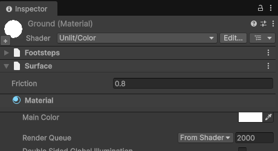

# Custom Asset Metadata

Store your own data with Unity assets. You write metadata classes, add them to an asset in its inspector, and look them up from that asset in the editor and at runtime.



Metadata is stored inside the asset file, so it can only be added to assets Unity stores in its own format: materials, ScriptableObject assets, animation clips, render textures and the like. Imported assets (textures, models, audio), prefabs, scenes and folders cannot hold metadata.

## Install

Requires Unity 6000.3 or newer.

In the Package Manager, press **+**, choose **Add package from git URL** and enter

```
https://github.com/RadicalCSG/CustomAssetMetadata.git
```

The **Samples** tab of the package has a small example project.

## Writing metadata

A metadata class derives from `CustomAssetMetadata`, which is a `ScriptableObject`. Like any ScriptableObject, each one needs a file of the same name (`SurfaceMetadata.cs` below); without it Unity cannot load the metadata back, so the class is not offered.

```cs
[AddMetadataMenu("Rendering/Surface")]
[DisallowMultipleCustomAssetMetadata]
[RestrictMetadataAssetTypes(typeof(Material))]
public class SurfaceMetadata : CustomAssetMetadata
{
    public float friction = 0.5f;

    // Called when the metadata is added to an asset
    public override void OnReset() { friction = 0.5f; }
}
```

- `AddMetadataMenu(path, order)` places the class in the add menu; lower `order` values come first.
- `DisallowMultipleCustomAssetMetadata` allows one of this type (or a subtype) per asset.
- `RestrictMetadataAssetTypes(types)` only allows assets of these types, or of types derived from them.
- `System.ComponentModel.DisplayName` changes the name shown in the inspector.

## In the editor

The **+** at the bottom left of an asset's inspector header adds metadata. Each metadata gets a title bar under the header, like a component: click it to fold the metadata away, and remove it from its menu or with a right click. The asset's own inspector follows under a title bar of its own. With several assets selected, metadata they all have is edited together.

From code:

```cs
var surface = material.AddMetadataOfType<SurfaceMetadata>();
AssetMetadataUtility.Destroy(surface);
AssetMetadataUtility.CanAddMetadataType(material, typeof(SurfaceMetadata));
```

Adding or removing metadata saves the asset, and can be undone. Assets that hold metadata get the `AssetMetadata` label.

## At runtime

```cs
var surface = material.GetMetadataOfType<SurfaceMetadata>();
if (material.HasMetadataOfType<SurfaceMetadata>()) { ... }
var owner = surface.AssociatedAsset;
```

When building a player, the metadata of every asset the build includes (through its scenes, Resources folders or preloaded assets) is copied into `Assets/Resources/__AssetMetadata`, and removed again afterwards. Metadata of assets that only live in AssetBundles or Addressables is not available in a player.

## Changes

See [CHANGELOG.md](CHANGELOG.md).

## License

MIT, see [LICENSE.md](LICENSE.md).
